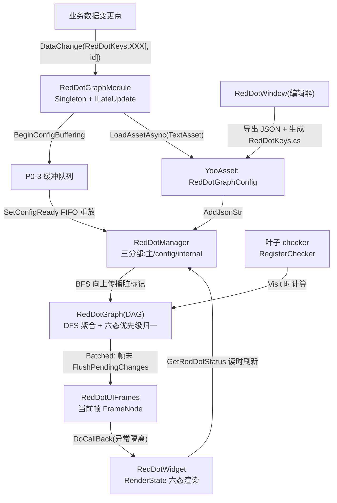

# 红点系统（RedDotGraph）

<cite>
**本文引用的文件**
- [RedDotGraphModule.cs](file://Assets/GameScripts/HotFix/GameLogic/Module/RedDotGraph/RedDotGraphModule.cs)
- [RedDotManager.cs](file://Assets/GameScripts/HotFix/GameLogic/Module/RedDotGraph/Runtime/RedDot/RedDotManager.cs)
- [RedDotManager_config.cs](file://Assets/GameScripts/HotFix/GameLogic/Module/RedDotGraph/Runtime/RedDot/RedDotManager_config.cs)
- [RedDotConst.cs](file://Assets/GameScripts/HotFix/GameLogic/Module/RedDotGraph/Runtime/RedDot/RedDotConst.cs)
- [RedDotGraph.cs](file://Assets/GameScripts/HotFix/GameLogic/Module/RedDotGraph/Runtime/RedDot/RedDotGraph.cs)
- [RedDotKey.cs](file://Assets/GameScripts/HotFix/GameLogic/Module/RedDotGraph/Runtime/RedDot/RedDotKey.cs)
- [RedDotKeys.cs](file://Assets/GameScripts/HotFix/GameLogic/Module/RedDotGraph/Runtime/RedDot/RedDotKeys.cs)
- [RedDotUIFrame.cs](file://Assets/GameScripts/HotFix/GameLogic/Module/RedDotGraph/Runtime/UI/RedDotUIFrame.cs)
- [RedDotWidget.cs](file://Assets/GameScripts/HotFix/GameLogic/System/Common/RedDotWidget.cs)
- [RedDotKeyBinder.cs](file://Assets/GameScripts/HotFix/GameLogic/System/Common/RedDotKeyBinder.cs)
- [RedDotWindow.cs](file://Assets/Editor/RedDotGraph/RedDotWindow.cs)
- [RedDotKeysGenerator.cs](file://Assets/Editor/RedDotGraph/RedDotKeysGenerator.cs)
- [RedDotGraphData.cs](file://Assets/Editor/RedDotGraph/Data/RedDotGraphData.cs)
</cite>

## 目录
1. [简介](#简介)
2. [项目结构](#项目结构)
3. [核心概念](#核心概念)
4. [架构总览](#架构总览)
5. [业务接入指南](#业务接入指南)
6. [编辑器工作流](#编辑器工作流)
7. [性能考量](#性能考量)
8. [故障排查指南](#故障排查指南)
9. [结论](#结论)

## 简介
红点系统基于 DAG（有向无环图）实现多父聚合（同源 fermsi/RedDotGraph，与 LjdmwMiniClient 项目同源同 API），由 `RedDotGraphModule` 做 TEngine 集成。核心能力：

- **六态位掩码**：Null/红点/蓝点/红数字/蓝数字/"新"标签/满，覆盖优先级 `满 > 红点 > 蓝点 > 红数字 > 蓝数字 > 新`（`RedDotStatusRules`，位值不承载优先级）
- **帧绑定回调模型**：UI 经 `AddUI(key, cb, id)` 订阅"当前帧"，状态变化由库回调业务取数（`GetRedDotStatus` 读时刷新语义）
- **配置驱动**：编辑器可视化编辑 `.reddotgraph` 源资产 → 导出 JSON → YooAsset 按文件名 `RedDotGraphConfig` 加载
- **刷新模式**：`Immediate`（同帧派发）/ `Batched`（默认，入队 + `ILateUpdate` 帧末统一冲刷，`MaxDispatchPerFrame=64` 削峰）
- **动态节点**：列表项/期次红点运行时增删（`dyn:` 前缀 key），幂等注册、挂父走 DAG 环检测
- **分组子图**：编辑器支持分组（组根 + 引用节点），导出自动展平为多父 DAG

## 项目结构
```
Assets/GameScripts/HotFix/GameLogic/Module/RedDotGraph/   运行时（热更 GameLogic 程序集）
├── RedDotGraphModule.cs        TEngine 集成层（Singleton, ILateUpdate）：配置加载/checker 收口/帧驱动
└── Runtime/
    ├── Dag/DAG.cs              环检测（Insert 失败即拒绝）
    ├── DigraphList/            邻接表图结构（顶点/边/算术三分部）
    ├── RedDot/                 RedDotManager(三分部)/RedDotGraph/RedDotVertex/RedDotKey(s)/RedDotConst
    └── UI/                     RedDotUIFrames 全屏帧 + FrameNode（回调容器）
Assets/Editor/RedDotGraph/      编辑器（RedDot.Editor 命名空间）
├── RedDotWindow.cs             图编辑器主窗口（分组导航/双轴校验/导出门禁）
├── Data/                       RedDotGraphData(源资产真源)/组树派生/K-V 校验器
├── RedDotKeysGenerator.cs      导出时同步生成 RedDotKeys.cs（禁止手改）
└── DemoBuilder/                TEngine/RedDot/Build Demo Scene 一键构建
Assets/GameScripts/HotFix/GameLogic/System/Common/
├── RedDotWidget.cs             六态渲染 UIWidget（SetKey 动态换绑/本地直控）
└── RedDotKeyBinder.cs          prefab 固定绑定序列化载体 + 下拉 Attribute
Assets/AssetRaw/Configs/Other/RedDotGraphConfig.json   运行时配置（编辑器导出落点）
Assets/Editor/RedDotGraph/RedDotDemo.reddotgraph       Demo 源图
```

## 核心概念

| 概念 | 说明 |
|---|---|
| `RedDotKey` | `sealed class`（`Key` + `ExternalId`），隐式转 string；`externalId=-1` 表示聚合节点（不可注册 checker） |
| `RedDotKeys` | 生成物常量表（`All` 数组 + 每键命名字段），加载期与 JSON 双向对账（`ValidateKeysConsistency`） |
| checker | 叶子数据源计算函数 `(out RedDotStatus, out int)`，经 `RegisterChecker` 注册，**读时才刷新** |
| 帧模型 | `AddFrame/ChangeToFrame` 切换全屏面板帧，`AddUI` 只注册进当前帧；本项目单帧全局模式（`"Global"` 一次成型） |
| 配置缓冲 | `BeginConfigBuffering/SetConfigReady`：配置未就绪期 DataChange/AddUI/SetNodeEnabled 暂存，就绪后 FIFO 重放 |
| 门控 | `SetNodeEnabled(key,false)`：禁用吞报脏、不作 BFS 中继、读回 Null，双向对父链补发 |
| cell 汇总 | `SummarizeCells/ReleaseCellIds`：per-id 槽位收敛（列表场景批量对账） |

## 架构总览



**刷新链路**：`DataChange` 标脏（叶子 checker 失效）→ BFS 向上传播 → 帧末统一对脏链路 DFS 重算聚合 → 结果按覆盖优先级归一为单态 → 只通知当前帧的订阅回调 → 回调内 `GetRedDotStatus` 取数渲染。

## 业务接入指南

```csharp
// 1. 注册 checker（业务收口,零魔法数;聚合节点 externalId=-1 拒绝注册）
RedDotGraphModule.Instance.RegisterChecker(RedDotKeys.Mail_Unread, (out RedDotStatus s, out int n) =>
{
    int count = MailModule.UnreadCount;
    s = count > 0 ? RedDotStatus.RedDotStatusRedNumber : RedDotStatus.RedDotStatusNull;
    n = count;
});

// 2. 数据变更点报脏（禁止挂 UI 回调;未就绪期自动缓冲）
RedDotGraphModule.Instance.DataChange(RedDotKeys.Mail_Unread);
RedDotGraphModule.Instance.DataChange(RedDotKeys.Mail_Unread, mailId);   // per-id

// 3. UI 绑定:RedDotWidget（UIWidget 派生,纯 C#）
//  prefab 固定绑定:节点挂 RedDotKeyBinder（下拉选 key）+ UIBindComponent 八槽位
//  动态绑定（列表复用/Tab 数据驱动）:
m_widget.SetKey(RedDotKeys.Mail_Unread.Key, cellId);
m_widget.ClearKey();
m_widget.SetLocalState(RedDotStatus.RedDotStatusRedDot);   // 本地直控(不入树,零订阅)
```

**UIBindComponent 八槽位**（与 `RedDotWidget_Gen.g.cs` 索引严格一致）：
`0=goFullDot 1=goDotTips 2=goReddot 3=goReddotNum 4=tmpReddot(TMP) 5=goBluedot 6=goBluedotNum 7=tmpBluedot(TMP)`
（3/6 为 Image 底色节点 + 子 TMP 文本节点两层；数字封顶 `CountCap` 默认 99+）

**动态节点**（列表项/期次）：

```csharp
RedDotGraphModule.Instance.RegisterDynamicNode(RedDotKeys.Mail.Key, out string dynKey);  // 幂等
RedDotGraphModule.Instance.SetDynamicParent(dynKey, RedDotKeys.Mail.Key);
RedDotGraphModule.Instance.BindDynamicChecker(dynKey, checker);
RedDotGraphModule.Instance.RemoveDynamicNode(RedDotKeys.Mail.Key);   // 摘边/摘 checker/父链补发
```

**生命周期**：`GameApp.StartGameLogic` 已接线 `EnsureStarted()`（首启激活；再次调用即 `Reinitialize()` 全量重建）。重登/切号若不重走 StartGameLogic，需业务在登录流程自行再调 `EnsureStarted()`，且**必须在 UI 重建之后调用**，否则存量 widget 订阅丢失红点失联。

## 编辑器工作流

1. 双击 `.reddotgraph` 资产（或 Inspector "Open Red Dot Editor"）打开 `RedDotWindow`
2. 画布建节点（右键创建）→ 节点配置 key/逻辑ID（模糊搜索选择器，可内联新建）→ 六态掩码勾选
3. **分组**：建组后组内首节点即组根（橙框），在主图/父组放引用节点连接；左栏组树面板导航/校验/主副迁移
4. **导出**：工具栏导出按钮 → K1-K6 + V1-V9 双轴校验门禁 → 写 `AssetRaw/Configs/Other/RedDotGraphConfig.json` + 同步再生成 `RedDotKeys.cs`
5. 工具栏按钮"使用说明"打开帮助窗；菜单 `Tools/红点系统/生成Key常量表(选导出JSON)`（CI 复跑）。编辑器实际菜单仅三个：`Assets/Create/红点图`、`Tools/红点系统/生成Key常量表(选导出JSON)`、`TEngine/RedDot/Build Demo Scene`

Demo：场景 `Assets/Scenes/RedDotDemoScene.unity`（流程 `ProcedureSetting_RedDot`），构建菜单 `TEngine/RedDot/Build Demo Scene`；覆盖六态展示/交互报脏/动态节点增删/门控。

## 性能考量

- **零轮询**：脏传播只在 `DataChange` 发生；checker 读时刷新（数据未报脏不计算）；Batched 帧末合并（默认，`MaxDispatchPerFrame=64` 削峰抗风暴）
- **零分配热点**：状态查询 out 参数无装箱；TMP `SetText(format, float)` 零分配重载；回调快照小池复用
- **单帧全局模式**：`AddFrame("Global")` 一次成型，永不切帧（被盖窗口照常收通知，可见性跳过待 Profiler 数据支撑）
- **图规模**：邻接表 `O(V+E)`，加载期 `ValidateKeysConsistency` 双向对账把 JSON/热更 dll 版本错配从运行期静默错变为启动即报

## 故障排查指南

| 现象 | 原因与处置 |
|---|---|
| `Could not found location [RedDotGraphConfig]` | 收集器未覆盖 `AssetRaw/Configs/Other` 或 JSON 未导出；模块 Warning 后图保持为空，业务操作照常 |
| `RedDotKeys 常量表与图配置不一致` | JSON 与热更 dll 版本错配（改图没重新导出/发版），启动即 Warning 汇总 |
| `红点配置加载失败 N 项` | 配置期仅结构错误（环/引用悬空）硬失败；叶子缺 checker 不在加载期拦截（checkVisitor 已关闭），降级为运行期 Warning——叶子补 `RegisterChecker` |
| `构成了环` | 配置图成环，硬失败拒载；检查导出源图（引用节点接线） |
| `为聚合节点(externalId=-1)不可注册 checker` | 改用其子叶子 key 注册 |
| UI 红点不刷新 | widget 未 SetKey/未挂 RedDotKeyBinder；或重登 Reinitialize 早于 UI 重建导致订阅丢失 |
| `请使用I2Localization.asset导出CSV...` 等 Warning | 框架级既有提示，与红点无关 |

## 结论
红点系统以"配置驱动 + 事件驱动 + 帧末批处理"组合把 UI 红点从业务界面中完全解耦：业务只做两件事（数据点报脏、叶子提供 checker），UI 只做一件事（RedDotWidget 绑定 key）。结构与键表全部由编辑器单点维护并双轴校验，保证图、JSON、常量表三方一致性。业务迁移前须确认 `EnsureStarted` 接线时序（重登场景），存量 widget 兼容方案见 `Books/3-9-红点模块.md`。
